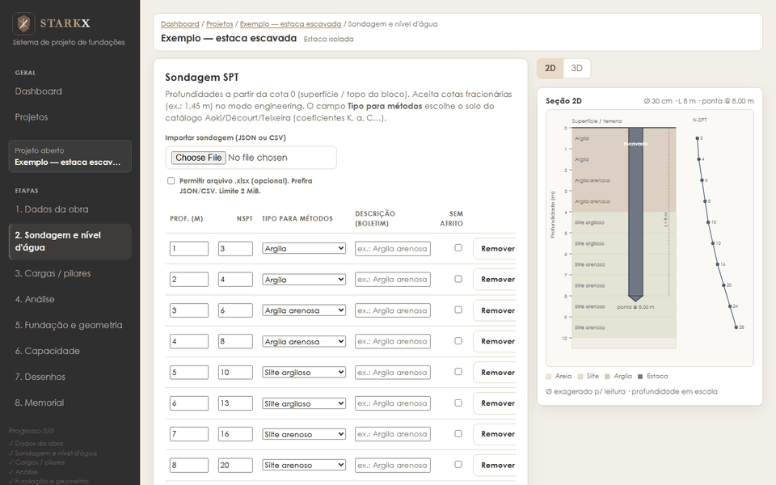
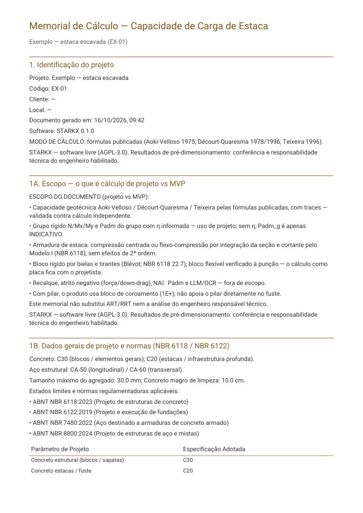

<p align="center">
  
</p>

<p align="center">
  <b>Projeto de fundações no navegador</b><br>
  Estacas pelo SPT, blocos, sapatas, tubulões e radier, com pranchas e memorial de cálculo.
</p>

<p align="center">
  <a href="https://starkx-publico.vercel.app"><b>▶ Abrir o STARKX</b></a>
  &nbsp;·&nbsp;
  <a href="docs/GUIA.md"><b>Guia passo a passo</b></a>
  &nbsp;·&nbsp;
  <a href="docs/exemplos/exemplo-pranchas.pdf">Pranchas de exemplo (PDF)</a>
  &nbsp;·&nbsp;
  <a href="docs/exemplos/exemplo-memorial.pdf">Memorial de exemplo (PDF)</a>
</p>



Capacidade de carga de estacas pelo SPT, grupo e bloco sobre estacas, armadura da estaca, sapata,
tubulão e radier, com pranchas, quantitativos e memorial de cálculo.

Tudo roda no navegador. Não há servidor nem cadastro; os projetos ficam salvos no próprio
navegador e podem ser exportados.

> **Aviso.** Os resultados são de pré-dimensionamento. Confira-os antes de usar em projeto
> executivo. O STARKX não substitui a análise nem a responsabilidade técnica (ART/RRT) de
> engenheiro habilitado.

## Como usar

1. Abra **<https://starkx-publico.vercel.app>** e clique em **Começar gratuitamente**.
2. Crie um projeto e clique em **Carregar exemplo** para ver tudo preenchido.
3. Siga as etapas: sondagem → cargas → análise → fundação → capacidade → desenhos → memorial.

O [guia](docs/GUIA.md) mostra cada etapa com imagens e termina conferindo à mão o resultado do
exemplo (Aoki-Velloso e Décourt-Quaresma).

| Sondagem | Sugestão da fundação |
|---|---|
|  |  |
| **Capacidade pelos 3 métodos** | **Estaca no perfil 3D** |
|  |  |
| **Prancha do bloco** | **Memorial em PDF** |
|  |  |

## O que calcula

| Elemento | Método |
|---|---|
| Estaca (geotecnia) | Aoki-Velloso (1975), Décourt-Quaresma (1978/1996) e Teixeira (1996); governante = mínimo |
| Estaca (concreto) | NBR 6122 Tabela 4 + NBR 6118: compressão, flexo-compressão por integração da seção, cortante (Modelo I) |
| Grupo e bloco | Reações de bloco rígido, eficiência de Converse-Labarre (sugestão), bielas e tirantes (Blévot), punção no bloco flexível |
| Sapata | σadm ou Vesic (1975) em serviço; sapata rígida, flexão CEB-70, biela e punção |
| Tubulão | Ponta (σadm ou Vesic) + fuste (informado ou Aoki-Velloso), fuste de concreto, base alargada |
| Radier | Área e tensões (geotécnico) |

Fórmulas, tabelas, normas e limitações: [`docs/METHODS.md`](docs/METHODS.md).
Como os números são conferidos: [`docs/VALIDATION.md`](docs/VALIDATION.md).

Fora do escopo: recalques, efeitos de 2ª ordem, atrito negativo, esforços em placas (radier e bloco
flexível como placa).

## Rodar no seu computador

Requer Node.js 22 (ou 20.19+).

```sh
npm install
npm install --prefix apps/web
npm run dev          # http://localhost:5173
```

Testes:

```sh
npm test             # unitários e integração (vitest)
npm run typecheck
npm run test:e2e     # navegador (Playwright: npx playwright install chromium)
npm run ci           # tudo
```

## Estrutura

```
calculation-engine/   capacidade de estacas (SPT)
structural-engine/    estaca de concreto armado e quantitativos
pile-group-engine/    reações e verificação do grupo
block-engine/         bloco sobre estacas
footing-engine/       sapata
caisson-engine/       tubulão
raft-engine/          radier
conception-engine/    sugestão de tipo, diâmetro, comprimento e número de estacas
assist-engine/        alertas, importação de sondagem, snapshot do projeto
memorial-engine/      memorial de cálculo (Markdown, HTML, PDF)
drawing-engine/       pranchas (PDF e SVG)
domain/               modelo de domínio e adaptadores
apps/web/             interface (React + Vite)
tools/reference/      implementação de referência independente (Python) usada nos testes
tests/, e2e/          testes
docs/                 métodos, validação e decisões
```

Os motores não dependem da interface: podem ser usados em scripts e testes.

## Contribuir

Veja [`CONTRIBUTING.md`](CONTRIBUTING.md). Correções de cálculo precisam citar a fonte (norma ou
publicação) e vir com teste.

## Licença

[GNU AGPL-3.0](LICENSE). Quem oferecer uma versão modificada como serviço na rede precisa
disponibilizar o código dessa versão. O nome e o logotipo STARKX não fazem parte da licença
(ver [`NOTICE`](NOTICE)).
