# Guia do STARKX — passo a passo com o exemplo

Este guia percorre um projeto completo no STARKX: sondagem, cargas, escolha da fundação,
capacidade de carga, pranchas e memorial. No fim, você confere um resultado à mão.

**Abra o app:** <https://starkx-publico.vercel.app> — roda no navegador, sem cadastro e sem
instalar nada. Os projetos ficam salvos no seu navegador.

> Os resultados são de **pré-dimensionamento**. O STARKX serve para estudar e comparar soluções;
> não substitui a análise nem a responsabilidade técnica (ART/RRT) de engenheiro habilitado.

**Sumário**

1. [Criar o projeto](#1-criar-o-projeto)
2. [Dados da obra](#2-dados-da-obra)
3. [Sondagem e nível d'água](#3-sondagem-e-nível-dágua)
4. [Cargas e pilares](#4-cargas-e-pilares)
5. [Análise: que fundação usar?](#5-análise-que-fundação-usar)
6. [Fundação e geometria](#6-fundação-e-geometria)
7. [Capacidade de carga](#7-capacidade-de-carga)
8. [Desenhos (pranchas)](#8-desenhos-pranchas)
9. [Memorial de cálculo](#9-memorial-de-cálculo)
10. [Confira à mão: Aoki-Velloso e Décourt-Quaresma](#10-confira-à-mão)
11. [Exercícios sugeridos](#11-exercícios-sugeridos)

---

## 1. Criar o projeto

Na página inicial, clique em **Começar gratuitamente**. No painel, clique em **+ Novo projeto**,
dê um nome e clique em **Criar e abrir**.

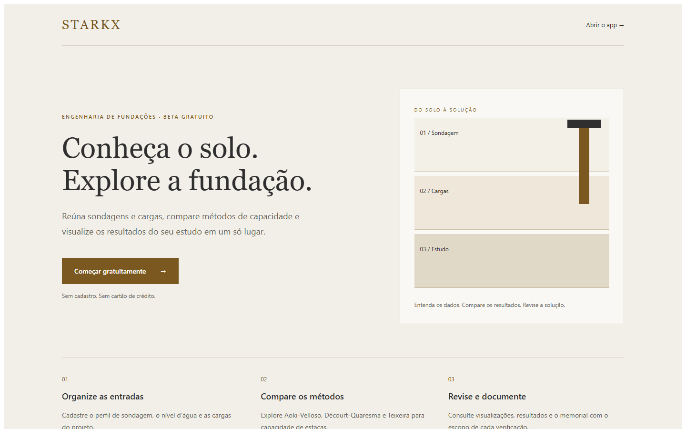


Para acompanhar este guia com os mesmos números, clique em **Carregar exemplo (estaca escavada
Ø30)** na barra lateral. O exemplo preenche todas as etapas.

## 2. Dados da obra

Nome, código, cliente, local, responsável técnico e CREA/CAU. Esses dados vão para o carimbo das
pranchas e para o memorial. A **cota do terreno** é a referência das profundidades.

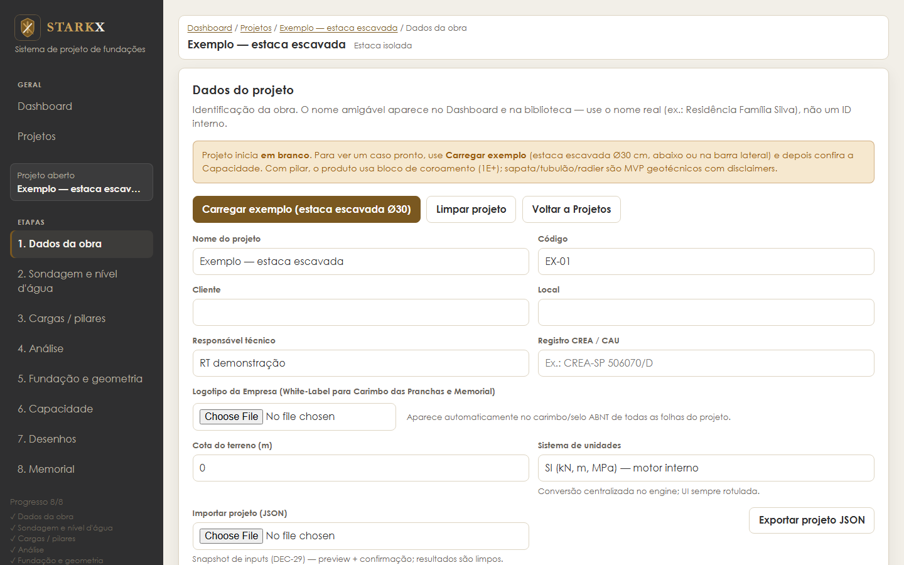

## 3. Sondagem e nível d'água

Uma linha por metro do boletim SPT:

| Campo | O que é |
|---|---|
| Prof. (m) | Profundidade do ensaio |
| NSPT | Golpes para os 30 cm finais |
| Tipo para métodos | Solo usado nas tabelas de coeficientes (K, α, C…) |
| Descrição | Texto livre do boletim (só para registro) |
| Sem atrito | Zera o atrito lateral naquele metro (ex.: aterro, camada que não deve contar) |

A sondagem pode ser importada de JSON, CSV ou Excel. O perfil desenhado à direita mostra as
camadas, o NSPT e a estaca. O nível d'água é opcional e aparece no perfil e no memorial.

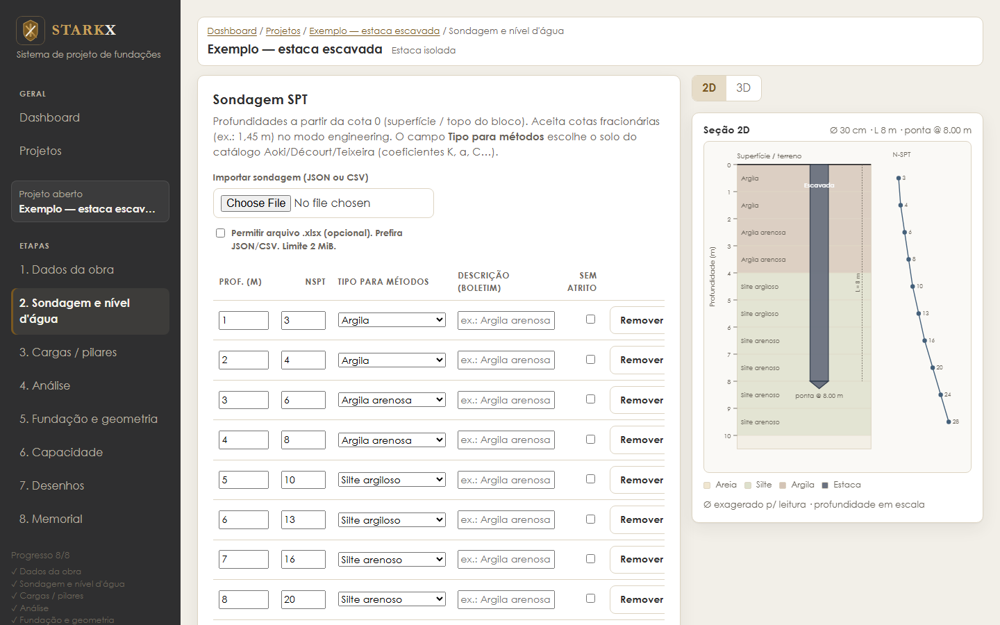

Sondagem do exemplo:

| Prof. (m) | 1 | 2 | 3 | 4 | 5 | 6 | 7 | 8 | 9 | 10 |
|---|---|---|---|---|---|---|---|---|---|---|
| NSPT | 3 | 4 | 6 | 8 | 10 | 13 | 16 | 20 | 24 | 28 |
| Solo | argila | argila | arg. arenosa | arg. arenosa | silte argiloso | silte argiloso | silte arenoso | silte arenoso | silte arenoso | silte arenoso |

## 4. Cargas e pilares

Cadastre cada pilar: dimensões (Dx, Dy), carga vertical **N** e, se houver, momentos (Mx, My) e
cortantes (Qx, Qy). Marque se as cargas já são **de cálculo** (majoradas); senão o STARKX as trata
como características (de serviço). No exemplo há um pilar, P01, com N = 150 kN.

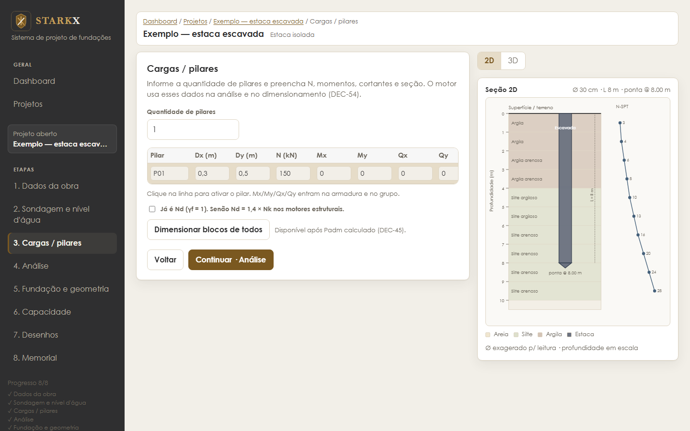

## 5. Análise: que fundação usar?

O STARKX olha a sondagem e as cargas e sugere um tipo de fundação, explicando o porquê:

- **Sapata** é ensaiada pilar a pilar: área pela tensão admissível, lado máximo de 4 m.
- A tensão admissível indicativa vem do SPT: σadm ≈ 20·N̄ (kPa), entre 50 e 350 kPa. Vale o menor
  entre o σadm que você informou e essa estimativa.
- **Solo fraco perto da superfície** (NSPT < 4 ou média < 6 até 3 m) descarta a sapata.
- **Camada mole abaixo da sapata** também descarta: o solo é verificado no bulbo de tensões, da
  base da sapata até cerca de 2B abaixo dela.
- Sem sapata viável, a sugestão é **bloco sobre estacas** (o pilar nunca apoia direto no fuste).

No exemplo, o solo raso é fraco (N = 3 a 6 até 3 m), então a sugestão é bloco sobre estacas. A
**concepção automática** propõe diâmetro, comprimento e número de estacas, com alternativas.

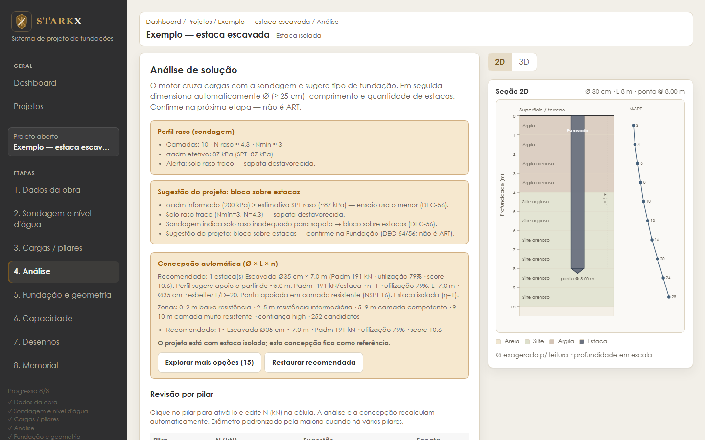

## 6. Fundação e geometria

Aqui você confirma o tipo e a geometria: categoria (moldada in loco, pré-moldada, metálica), tipo
de estaca, diâmetro, comprimento e cota do topo. Para sapata, tubulão e radier aparecem os
parâmetros correspondentes. Clique em **Calcular capacidade**.

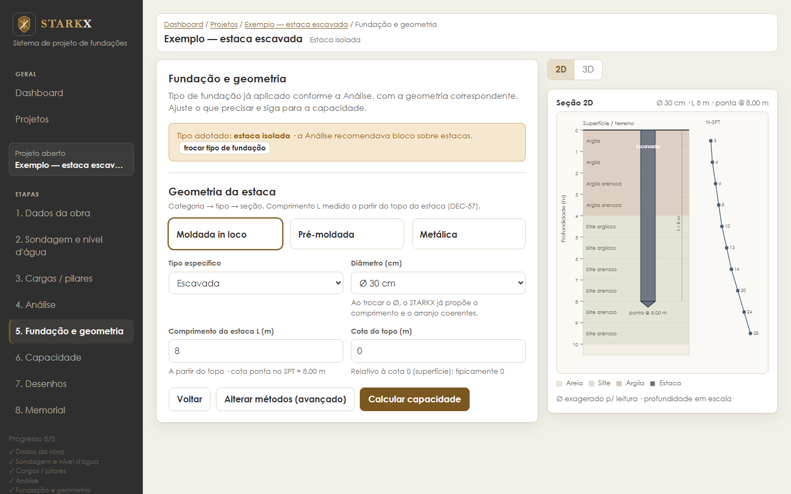

## 7. Capacidade de carga

A capacidade da estaca pelos três métodos semiempíricos, com o **governante = o menor**:

- **Aoki-Velloso (1975)**
- **Décourt-Quaresma (1978/1996)**
- **Teixeira (1996)**

O painel mostra o Padm governante, a média dos métodos, a carga estrutural usual da estaca e a
tabela com ponta (Rp), atrito lateral (Rl), carga de ruptura e admissível de cada método.

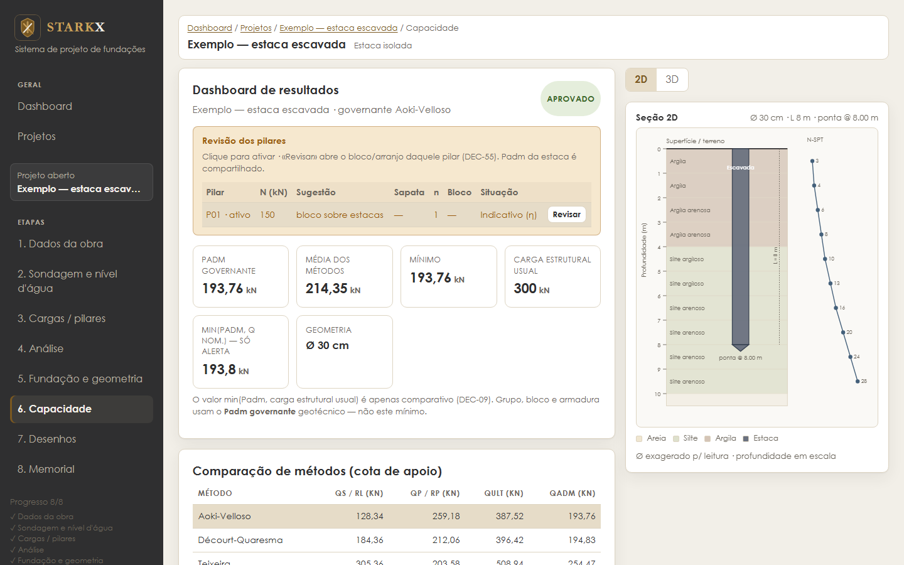

O botão **3D** mostra a estaca dentro do perfil de solo (dá para girar com o mouse):

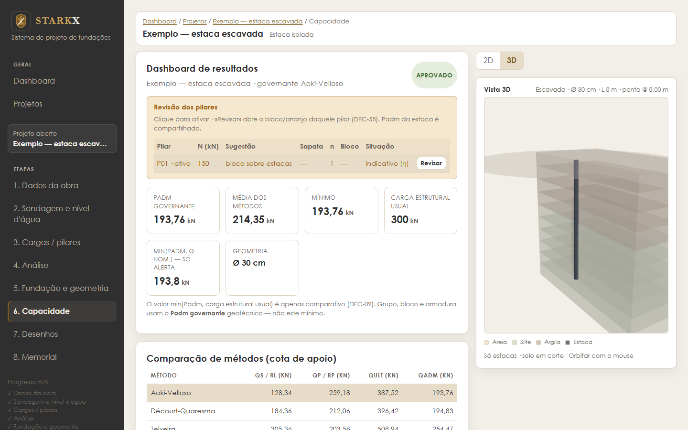

> **Atenção ao comparar números.** Nesta tela o exemplo ainda é uma estaca isolada com topo na cota
> 0 (L = 8,00 m, Padm = 193,76 kN). Quando o projeto vira bloco sobre estacas (etapas Bloco e
> Desenhos), o topo da estaca desce para 0,40 m (bloco de 50 cm com a estaca embutida 10 cm),
> L passa a 7,60 m e o Padm cai para **191,16 kN**. É esse o valor do memorial e da seção 10.

## 8. Desenhos (pranchas)

O caderno de pranchas A4 tem folha de rosto com quadro geral, uma prancha por bloco ou sapata e a
estaca típica. Cada prancha traz planta, corte, desdobramento das barras, relação do aço e volumes
de concreto. Baixe o caderno inteiro em PDF ou uma prancha em PDF/SVG.

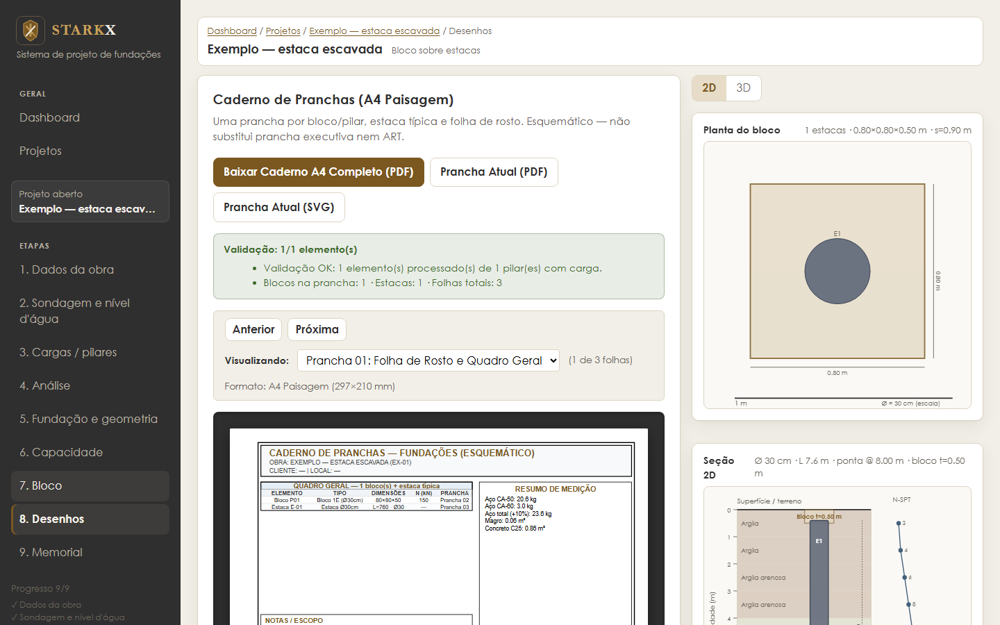

| Bloco | Estaca típica |
|---|---|
| 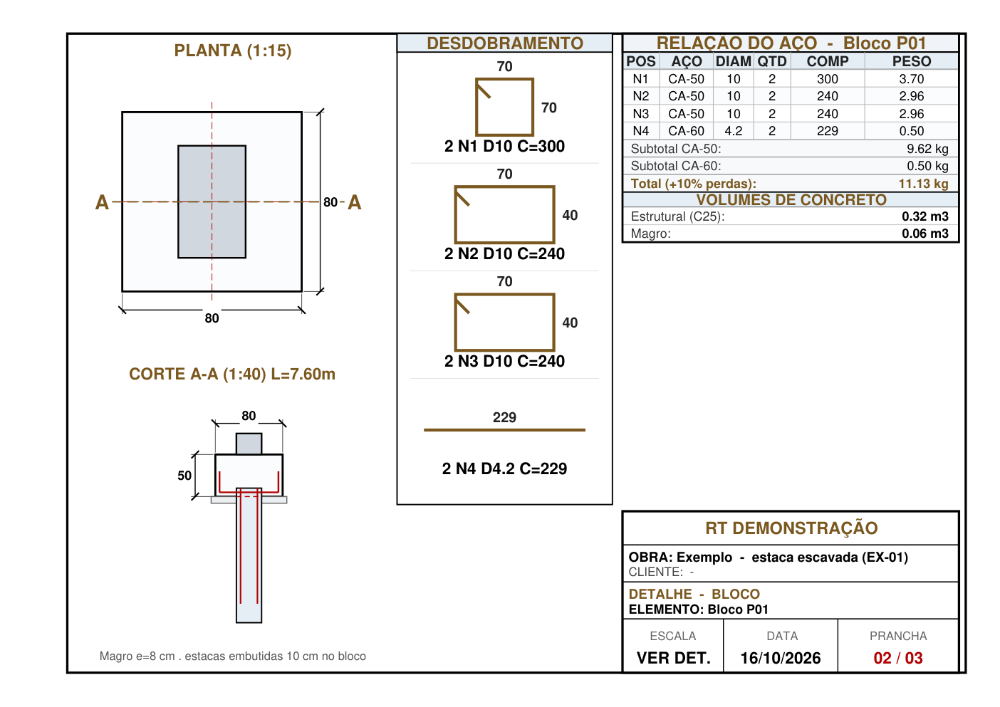 | 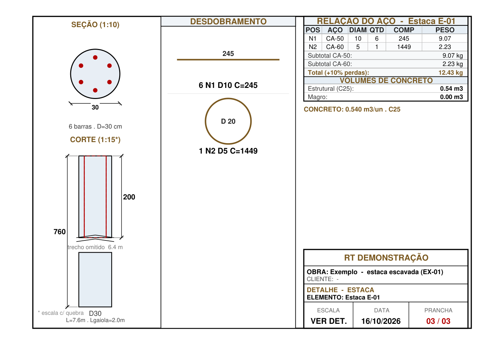 |

São desenhos **esquemáticos**: não substituem a prancha executiva.

## 9. Memorial de cálculo

O memorial reúne dados, normas, sondagem, cargas, os três métodos com as fórmulas, armadura e
quantitativos. Baixe em PDF ou Markdown, ou imprima.

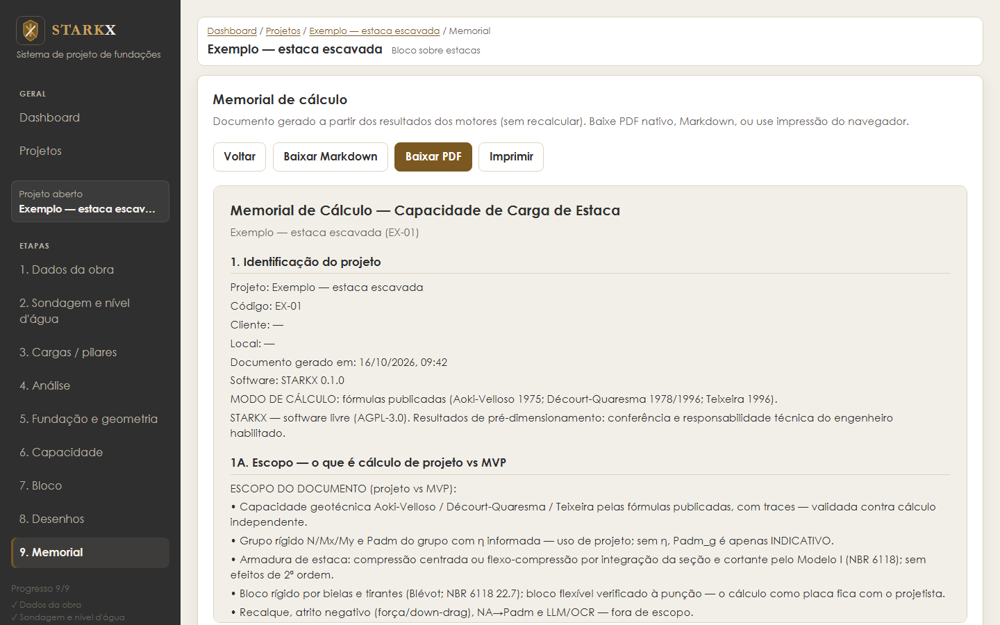

**Exemplos prontos para baixar** (gerados pelo app com o projeto de exemplo):

- [Caderno de pranchas (PDF)](exemplos/exemplo-pranchas.pdf)
- [Memorial de cálculo (PDF)](exemplos/exemplo-memorial.pdf)

## 10. Confira à mão

Um bom exercício é refazer um método e chegar ao mesmo número do memorial. Exemplo: estaca
escavada Ø 30 cm, topo a 0,40 m, ponta a 8,00 m (L = 7,60 m).

Dados geométricos:

- Ap = π·0,30²/4 = **0,0707 m²**
- U = π·0,30 = **0,9425 m**

### Aoki-Velloso

```
Rp = K·N·Ap / F1            Rl = Σ U·α·K·N·Δz / F2            Padm = (Rp + Rl)/2
```

Escavada: F1 = 3,0 e F2 = 6,0 (Cintra & Aoki, 2010). K e α da tabela de Aoki & Velloso (1975):

| Solo | K (kPa) | α |
|---|---|---|
| Argila | 200 | 6,0 % |
| Argila arenosa | 350 | 2,4 % |
| Silte argiloso | 230 | 3,4 % |
| Silte arenoso | 550 | 2,2 % |

**Ponta** (8 m, silte arenoso, N = 20): Rp = 550 · 20 · 0,0707 / 3 = **259,18 kN**

**Fuste**, camada a camada:

| Trecho | Solo | N | Δz (m) | α·K·N·Δz (kN/m) |
|---|---|---|---|---|
| 0,4–1 m | argila | 3 | 0,6 | 0,06·200·3·0,6 = 21,60 |
| 1–2 m | argila | 4 | 1 | 48,00 |
| 2–3 m | argila arenosa | 6 | 1 | 50,40 |
| 3–4 m | argila arenosa | 8 | 1 | 67,20 |
| 4–5 m | silte argiloso | 10 | 1 | 78,20 |
| 5–6 m | silte argiloso | 13 | 1 | 101,66 |
| 6–7 m | silte arenoso | 16 | 1 | 193,60 |
| 7–8 m | silte arenoso | 20 | 1 | 242,00 |
| **Soma** | | | | **802,66** |

Rl = 0,9425 · 802,66 / 6 = **126,08 kN**

Padm = (259,18 + 126,08) / 2 = **192,63 kN** ✓ (memorial: 192,63 kN)

### Décourt-Quaresma

O memorial dá Rp = 212,06 kN e Rl = 179,59 kN. O Padm é o menor entre dois critérios:

```
Padm = min( (Rp + Rl)/2 ; Rl/1,3 + Rp/4 )
     = min( 195,83 ; 138,15 + 53,02 ) = 191,16 kN
```

Aqui governa o segundo critério, que pesa mais o atrito lateral. E 191,16 kN é o menor dos três
métodos (Aoki 192,63; Teixeira 251,45), por isso é o **Padm governante** do projeto.

Fórmulas completas, tabelas e limitações: [METHODS.md](METHODS.md). Como o STARKX confere os
próprios números: [VALIDATION.md](VALIDATION.md).

## 11. Exercícios sugeridos

1. **Comprimento.** Encurte a estaca do exemplo para 6 m. Qual método governa agora e por quê?
2. **Tipo de estaca.** Troque escavada por hélice contínua (F1 = 2,0; F2 = 4,0). Quanto o Padm de
   Aoki-Velloso aumenta? Confira à mão só a ponta.
3. **Sapata x estaca.** Crie uma sondagem com NSPT ≥ 15 desde 1 m e um pilar de 600 kN. A análise
   sugere sapata? Agora coloque NSPT = 3 entre 3 e 6 m e veja a sugestão mudar (bulbo de tensões).
4. **Grupo.** Aumente a carga de P01 para 900 kN e veja o arranjo de estacas e o bloco que o
   STARKX propõe. Compare a carga por estaca com o Padm.
5. **Nível d'água.** Informe NA a 1,5 m num projeto de sapata. Que alerta aparece?

---

Código-fonte e contribuições: <https://github.com/reyddner/starkx> · Licença AGPL-3.0.
Para regenerar as imagens deste guia: `node tools/screenshots/capture.mjs`.
